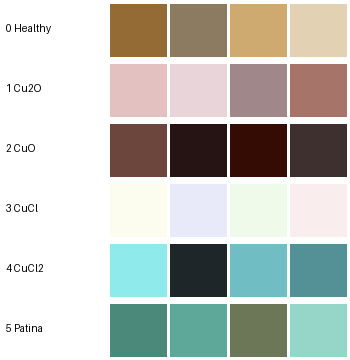

# Input-data audit

Generated by `python -m cucorr.cli audit`.

## Workbooks

- **settings.xlsx / settings**: 6 rows x 6 cols; columns `id` (int64), `title` (str), `rep_color` (str), `ref1` (str), `ref2` (str), `ref3` (str); missing values: 0
- **labels.xlsx / manifest**: 660 rows x 7 cols; columns `version` (int64), `cluster_id` (int64), `lab_l` (float64), `lab_a` (float64), `lab_b` (float64), `annotation_title` (str), `NAVICAT_ROWID` (int64); missing values: 0

## Classes and reference colours (settings.xlsx)

| ID | Class | settings id | rep_color | ref1 | ref2 | ref3 |
|---|---|---|---|---|---|---|
| 0 | Healthy | 1 | (148, 106, 53) | (140, 122, 97) | (207, 170, 112) | (226, 210, 179) |
| 1 | Cu2O | 2 | (226, 193, 192) | (232, 212, 217) | (160, 135, 137) | (166, 116, 104) |
| 2 | CuO | 3 | (108, 69, 61) | (38, 20, 20) | (52, 12, 3) | (63, 48, 48) |
| 3 | CuCl | 4 | (253, 253, 239) | (232, 234, 249) | (240, 250, 235) | (250, 237, 238) |
| 4 | CuCl2 | 5 | (143, 235, 235) | (31, 38, 42) | (112, 189, 195) | (84, 145, 151) |
| 5 | Patina | 6 | (75, 137, 122) | (94, 168, 154) | (107, 119, 87) | (150, 214, 201) |

## Manifest (labels.xlsx)

- Rows: 660; versions: {3: 660}; cluster_id range [1, 697], 0 duplicates, 37 gaps.
- Duplicate Lab rows: 0; rows outside the sRGB gamut: 0.
- Extra columns: ['version', 'NAVICAT_ROWID'].
- Class names compatible with settings.xlsx: True.

| Class | Clusters | mean L* | mean a* | mean b* |
|---|---|---|---|---|
| Healthy | 267 | 64.7 | 5.1 | 26.0 |
| CuCl2 | 86 | 65.4 | -20.2 | -9.1 |
| Patina | 82 | 60.8 | -21.8 | 3.8 |
| CuCl | 79 | 79.6 | -7.9 | -0.6 |
| CuO | 74 | 19.8 | 12.9 | 7.7 |
| Cu2O | 72 | 71.8 | 10.8 | 4.3 |

## Cross-file consistency

Nearest settings reference (CIEDE2000, D65) reproduces the manifest label for **86.2%** of clusters.

Rows = manifest label, columns = class of nearest settings reference colour:

| manifest \ nearest | Cu2O | CuCl | CuCl2 | CuO | Healthy | Patina |
|---|---|---|---|---|---|---|
| Cu2O | 68 | 1 | 0 | 1 | 2 | 0 |
| CuCl | 13 | 28 | 5 | 3 | 0 | 30 |
| CuCl2 | 0 | 0 | 78 | 0 | 0 | 8 |
| CuO | 1 | 0 | 1 | 71 | 1 | 0 |
| Healthy | 1 | 12 | 0 | 4 | 250 | 0 |
| Patina | 0 | 0 | 8 | 0 | 0 | 74 |

## Warnings

- 22 RGB cells contain trailing whitespace/newlines (stripped on parse).
- CuCl2: reference (31, 38, 42) is dE2000=75.0 from rep_color (143, 235, 235); verify it is not a mis-entry.
- 37 cluster_ids absent from 1..max; clusters may have been deleted or filtered (version 3 only).

## Assumptions

- A1: Workbook RGB and image pixels are sRGB; CIELAB is D65 / 2-degree (skimage). Manifest Lab is assumed to use the same convention; not documented in the workbook.
- A2: settings.xlsx id k maps to class id k-1; class names match exactly between files.
- A3: rep_color and ref1..ref3 are all valid prototypes of the same class (multi-prototype).
- A4: manifest rows are expert-labelled colour-cluster centroids (palette-level weak supervision), not image identifiers and not pixel ground truth.

## Unresolved

- Which images/pixels each cluster_id was derived from (no image reference in manifest).
- Clustering algorithm, colour space and white point used to compute the manifest Lab values.
- Meaning of `version` (all rows = 3) and NAVICAT_ROWID (database export key; ignored).
- Camera, lighting, calibration (px/mm) and specimen/session identifiers for the ~500 images.
- Existence of any dense expert masks; none were supplied.
- Whether class labels are supported by chemical characterisation (XRD/Raman/XPS) for any specimen.
