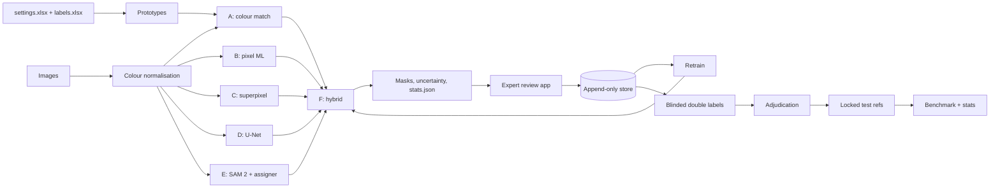
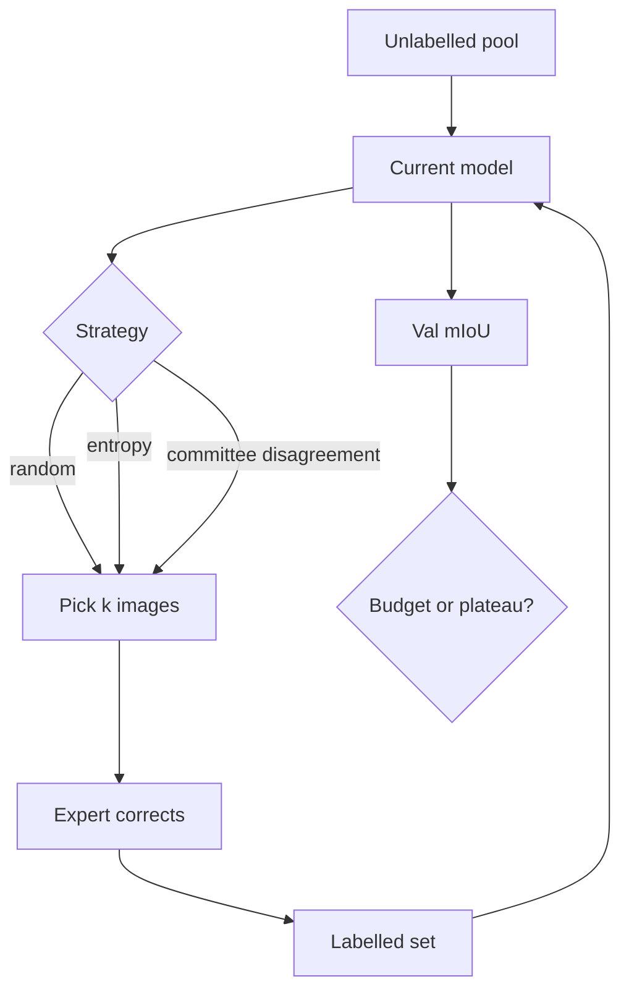

# Research paper template

> Status legend: **[E]** established knowledge (cite it), **[P]** proposed method, **[H]** hypothesis to test,
> **[R]** result (fill in only from `benchmark.json` on adjudicated test masks). No results exist yet.

## Working title
Expert-in-the-loop semantic segmentation of copper corrosion products: comparing colour-reference,
classical, deep and foundation-model approaches with inter-annotator-calibrated evaluation

## Abstract (template)
Background [E]. Problem: the cost of dense annotation and the ambiguity between corrosion products [E]. Method: six approaches under
one contract, with blinded double annotation and adjudication of N = __ images [P]. Results: mIoU __ [CI], κ = __ [R].
Conclusion, limited to visual classification and not chemical identity.

## Research questions and hypotheses
- **RQ1.** How far does expert reference-colour matching (A) get on its own? *H1 [H]:* CIEDE2000 beats RGB Euclidean distance on macro mIoU.
- **RQ2.** Do learned pixel or region classifiers (B, C) beat A when they have the same expert masks? *H2 [H]:* yes for CuCl/Patina, which overlap in colour (audit: 30 of 79 CuCl clusters lie nearest to Patina).
- **RQ3.** Does deep segmentation (D) help when only ~500 images and a small reference subset are available?
- **RQ4.** Does SAM 2 (E) improve boundaries without improving class labels? *H4 [H]:* boundary F1 goes up and the change in per-class IoU is not significant.
- **RQ5.** For the same review budget, does uncertainty- or disagreement-guided review beat random review? *H5 [H].*
- **RQ6.** How close does the best method come to the inter-annotator ceiling (κ and IoU between annotators)?

## Contributions (claims to test, not yet established)
1. An open, reproducible benchmark protocol with uncertainty-aware outputs [P].
2. Expert colour references and palette-level labels used as weak supervision [P].
3. Algorithm performance placed next to human agreement [P].
Novelty is not claimed until the systematic review (planned for §2) is done.

## Sections
1. Introduction: why copper corrosion matters [E]; why annotation is the bottleneck.
2. Related work: colour difference; superpixels and graphs; RF, SVM and GBM; U-Net and DeepLab; SAM; weak supervision; active learning; IRR; metrics (see `references.md`).
3. Materials: specimens, exposure conditions, imaging set-up and calibration (*still to be supplied*), and the workbooks (`data_dictionary.md`).
4. Annotation protocol (`annotation_protocol.md`).
5. Methods A–F (`methodology.md`).
6. Experimental design and statistics (`evaluation_protocol.md`).
7. Results (tables below) [R].
8. Discussion: where colour alone fails, and whether visual and chemical labels can be equated.
9. Limitations and threats to validity: no chemical ground truth; one camera/session; the manifest's origin is unknown;
   small test set; annotator expertise; the CuCl2 reference may have been mis-entered; pseudo-label circularity in Approach F.
10. Reproducibility and data availability; ethics (no human subjects; credit for annotator labour).
11. Future work: XRD/Raman validation, colour-chart calibration, multispectral imaging.

## Results table templates
**Table 1. Inter-annotator agreement.** Columns: pair, Cohen's κ [95% CI], binary κ, per-class IoU, boundary F1. Add Fleiss' κ when there are 3 or more annotators.
**Table 2. Main comparison.** Use the generated `benchmark.md` table as-is.
**Table 3. Ablations.** One row per entry in `configs/experiments.yaml`, giving Δ mIoU against the full model with a CI.
**Table 4. Robustness.** mIoU under each perturbation.
**Table 5. Annotation cost.** Review strategy against images reviewed, expert minutes, and val mIoU.
**Figure set:** class swatches, overlays of failure cases, coverage–risk curves, active-learning curves, confusion matrices.

## Diagrams (Mermaid)

